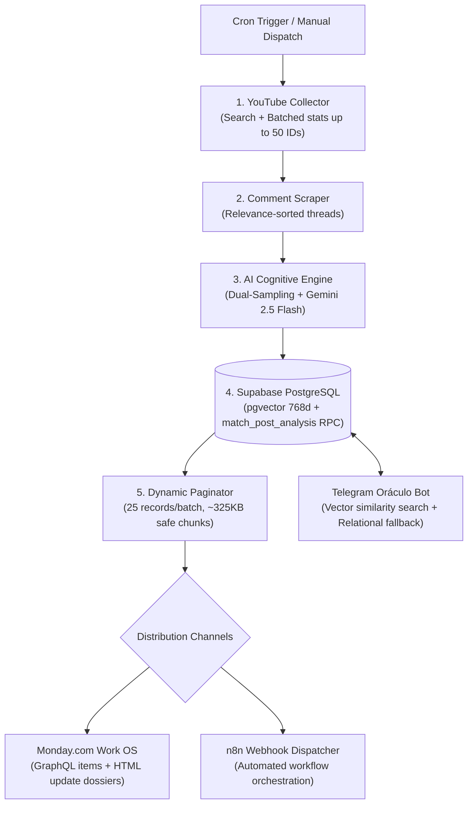

# 🏆 Trend Intelligence Engine — Semantic Listening & Social RAG

[](https://www.python.org/)
[](https://docs.pydantic.dev/)
[](https://deepmind.google/technologies/gemini/)
[](https://ai.google.dev/)
[](https://supabase.com/)
[](https://monday.com/)
[](https://n8n.io/)
[](https://telegram.org/)

> **[ 🇧🇷 Ler em Português ](README.pt-br.md)**

> **Executive Overview:** The **Trend Intelligence Engine** is a specialized social listening, media intelligence, and semantic analysis platform designed to extract high-conviction audience signals from digital video ecosystems. Operating on a **Software "Dark Kitchen"** architecture, heavy data ingestion, quota-optimized API batching, comment scraping, and LLM-driven cognitive synthesis run asynchronously in Python in the backstage. Enriched intelligence is then delivered directly to decision-makers via enterprise Work OS boards (**Monday.com** with rich HTML update dossiers), workflow automations (**n8n** webhooks), and interactive conversational search (**Telegram Oráculo** with pgvector RAG).

---

## 🎯 1. Commercial Value & Engineering Rationale

### The Problem: Late Reaction and Signal Blindness
Marketing directors, content strategists, and sports media teams frequently react late to cultural shifts and audience sentiment changes. Manually reading thousands of comments across hundreds of videos is impossible, while traditional keyword scrapers only count surface volumes, missing sarcasm, emergent community slang, and qualitative product friction.

### Narrative vs. Audience Reaction Contrast
Rather than merely summarizing video descriptions, the engine systematically contrasts:
* **The Creator's Thesis (The Narrative):** What the creator claims, defends, or sells in the video transcription and metadata.
* **The Audience's Real Reaction (The Friction):** What viewers actively debate, reject, question, or celebrate across the comment threads.

Using **Gemini 2.5 Flash** with strict structured JSON schemas and **Supabase pgvector (768-dimensional embeddings)**, the engine separates authentic business signals from background noise.

### Key Architectural Decisions
1. **YouTube API Quota Batching:** The YouTube Data API v3 enforces a default daily quota limit of 10,000 units. A standard search request (`youtube.search().list`) consumes 100 units. Requesting statistics individually for each returned video would consume 1 unit per call and quickly exhaust quotas. The engine gathers candidate video IDs first, then performs **batched statistics requests** via `youtube.videos().list(id=','.join(video_ids), part='statistics')` (up to 50 video IDs per single API call consuming only 1 unit), enabling high-coverage discovery within strict API constraints.
2. **Dual-Sampling Comment Heuristic:** Passing hundreds of complete comments into an LLM context window causes unnecessary token inflation, latency, and context dispersion. The engine implements a deterministic **Dual-Sampling** strategy:
   * **Top 10 Most-Liked Comments (`top_10`):** Ingested in full (author, text, likes) to capture high-conviction qualitative critique, major counterarguments, and top community sentiment.
   * **Sample of Up to 100 Comments (`sample_100`):** Truncated to 150 characters each to provide broad sentiment density, keyword emergence, and emotional tone.
   * *Impact:* Reduces context-window token consumption by >65% compared to raw comment feeds while retaining both depth of argument and statistical representation.
3. **Memory Buffer Protection (Dynamic Paginator):** When serializing large database queries into CLI stdout for container runners or n8n nodes, high-volume JSON payloads can exceed Node.js's runtime buffer ceiling (`stdout maxBuffer length exceeded (1MB)`). The engine implements a cursor-based paginator processing dynamic batches of 25 records (~325KB payload), ensuring safe execution in memory-constrained container environments.

---

## 🏗️ 2. System Architecture ("The Dark Kitchen")

The pipeline separates data intelligence from operational presentation:



### 📡 Pipeline Layers

* **Ingestion Layer (`src/collector.py`):** Config-driven keyword and subtopic queries via YouTube API v3. Uses candidate ID collection followed by batched statistics requests (up to 50 IDs/call) and filters candidates by minimum view counts and engagement ratios over elapsed time.
* **Comment Extraction (`src/scraper.py`):** Captures relevance-ordered comment threads via `youtube.commentThreads().list`, extracting author names, text, like counts, and publication timestamps with automatic deduplication in `post_comments`.
* **Cognitive Engine (`src/analyzer.py`):** Combines video metadata, video transcription (via `youtube-transcript-api`), and the **Dual-Sampling comment corpus** (Top 10 full + up to 100 truncated). Generates structured JSON via Gemini 2.5 Flash and produces 768-dimensional vector embeddings using `models/gemini-embedding-2` persisted into Supabase PostgreSQL.
* **Dynamic Paginator (`src/fetcher.py`):** Queries unexported analyses in 25-record batches (~325KB stdout) and compiles formatted payloads: Monday group IDs, sentiment status badges, relevance scores, and rich HTML update dossiers.
* **Work OS Integration (`src/export_to_monday.py`):** Issues typed GraphQL mutations to Monday.com, creating items under dynamic subtopic groups and posting detailed HTML briefing dossiers directly into item update bubbles.
* **Interactive Oráculo (`src/telegram_oraculo.py`):** Telegram bot allowing stakeholders to query indexed dossiers using natural language. Converts queries to 768d embeddings and executes PostgreSQL vector similarity search via `match_post_analysis(%s::vector, %s, %s)`, with automatic relational fallback to recent analyses if vector search yields no results.

---

## ⚽ 3. Media Intelligence Pilot: 2026 FIFA World Cup

To validate the framework in a realistic high-tempo sports media environment, a production pilot was configured around the **2026 FIFA World Cup** ecosystem:

* **Scope & Volume:** 163 high-impact videos indexed and analyzed across 5 strategic subtopics.
* **Dynamic Subtopic Categorization:**
  * `figurinhas`: Panini sticker album hype, collectible trading trends, and pricing sentiment.
  * `tatica`: Tactical analysis, post-match reviews, and formation debates.
  * `duvidas`: Squad speculation, national team call-up debates, and player form controversies.
  * `polemicas`: Ticketing costs, FIFA organizational logistics, and fan travel concerns.
  * `influencers`: Rising creators, react formats, and creator economy engagement.
* **Automated Group Mapping:** The engine dynamically resolves subtopics to designated Monday.com groups (`Figurinhas da Copa 2026`, `Tática e React de Jogos`, etc.), keeping content editorial boards structured without manual triaging.
* **Configuration Isolation:** All search queries, minimum engagement thresholds, and analysis angles are decoupled into `src/pilots/world_cup_2026/config.yaml`.

> [!NOTE]
> **Use Case Context:** This pilot was built as an independent engineering demonstration of sports media intelligence and audience sentiment analysis. It does not represent an official partnership, commercial contract, or endorsement by LiveMode, CazéTV, FIFA, or Panini.

---

## 🛡️ 4. Data Contracts & Architecture Resilience

### Strict Data Contracts (Pydantic v2)
System boundaries are governed by explicit Pydantic models (`src/models/schemas.py`), including `VideoMetadata`, `CommentPayload`, `SentimentAnalysisResult`, and `MondayItemPayload`. This ensures schema validation between data collection, AI cognitive processing, and downstream dispatchers.

### Defensive RAG with Relational Fallback
In `src/telegram_oraculo.py`, queries against the knowledge base use cosine similarity over pgvector embeddings:
```sql
SELECT * FROM match_post_analysis(query_embedding::vector, match_threshold, match_count);
```
If vector matching returns empty results or encounters connection timeouts, the system gracefully degrades to a relational fallback, retrieving the 5 most recent complete dossiers ordered by analysis timestamp.

---

## 🔍 5. Engineering Status & CI Hardening

To maintain strict traceability between the production baseline and ongoing improvements:

* **`main` Branch (Baseline):** Contains the core pipeline architecture, YouTube batching, Dual-Sampling cognitive engine, Supabase schema, Monday.com GraphQL integration, and the 2026 World Cup pilot configuration.
* **`fix/security-ci-recovery` Branch (Release Candidate):** Actively holds comprehensive CI/CD stabilization, test suite modernization (**29 unit tests** covering Pydantic contracts, heuristic parsers, and Monday export mappers), and credential hygiene verification. This branch is undergoing staged review and validation prior to Pull Request merge into `main`.

---

## 🚀 6. Local Setup & Quickstart

### Prerequisites
* Python 3.11+
* Docker & Docker Compose (optional, for local n8n instance)
* API Credentials:
  * YouTube Data API v3 (`YOUTUBE_API_KEY`)
  * Google Gemini API (`GEMINI_API_KEY`)
  * Supabase PostgreSQL connection string (`DATABASE_URL`)
  * Monday.com API Token (`MONDAY_API_TOKEN`)
  * Telegram Bot Token (`TELEGRAM_BOT_TOKEN`, optional for Oráculo)

### Installation
```bash
# 1. Clone repository
git clone https://github.com/jraphaelcunha/trend-intelligence-engine.git
cd trend-intelligence-engine

# 2. Configure virtual environment
python -m venv venv
source venv/bin/activate  # On Windows: venv\Scripts\activate

# 3. Install dependencies
pip install -r requirements.txt

# 4. Configure environment variables
cp .env.example .env
# Edit .env with your credentials
```

### Running the Pipeline Components
```bash
# Run YouTube collector for active pilot
python src/collector.py

# Extract comments for indexed videos
python src/scraper.py

# Run cognitive analysis with Gemini 2.5 Flash
python src/analyzer.py

# Export pending dossiers to Monday.com
python src/export_to_monday.py

# Start interactive Telegram Oráculo bot
python src/telegram_oraculo.py
```

### Running with Docker Compose
```bash
docker compose -f docker/docker-compose.yml up --build -d
```
The n8n orchestrator console will be available at [http://localhost:5678](http://localhost:5678).

---

## 📂 7. Repository Structure

```text
trend-intelligence-engine/
├── .github/
│   └── workflows/
│       ├── ci.yml                     # Automated Lint & Pytest Quality Gate
│       └── google-cloudrun.yml        # Google Cloud Run deployment workflow
├── docker/                            # Multi-stage Dockerfile & Compose definitions
├── n8n/                               # Exported n8n orchestration workflows
├── src/                               # Core Python source code
│   ├── models/
│   │   └── schemas.py                 # Pydantic v2 strict data contracts
│   ├── collector.py                   # YouTube API ingestion with batched stats
│   ├── scraper.py                     # Comment extraction & deduplication
│   ├── analyzer.py                    # Gemini 2.5 Flash cognitive engine & 768d embeddings
│   ├── fetcher.py                     # Dynamic 25-record paginator & Monday payload formatters
│   ├── export_to_monday.py            # Direct Monday.com GraphQL exporter
│   ├── telegram_oraculo.py            # Conversational RAG assistant with relational fallback
│   ├── utils/
│   │   └── db.py                      # Supabase PostgreSQL connection pooling
│   └── pilots/
│       └── world_cup_2026/            # Pilot configuration & subtopic taxonomy
├── scripts/
│   └── ops/                           # Operational and database maintenance utilities
├── tests/
│   ├── conftest.py                    # Pytest fixtures and API mocks
│   └── unit/
│       ├── test_schemas.py            # Pydantic contract validation tests
│       ├── test_fetcher.py            # Transformation & mapping unit tests
│       └── test_analyzer.py           # ID extraction & heuristic tests
├── requirements.txt                   # Production dependencies
├── README.md                          # English technical documentation
└── README.pt-br.md                    # Portuguese technical documentation
```

---

## 🗺️ 8. Roadmap

- [ ] **Multi-Platform Ingestion:** Extend collection pipeline beyond YouTube to TikTok and Instagram Reels video transcripts.
- [ ] **Multi-Tenant Board Routing:** Support dynamic routing across multiple Monday.com boards via webhook headers in n8n.
- [ ] **Proactive Trend Alerts:** Scheduled push notifications in Telegram when a subtopic exhibits anomalous negative friction or sudden engagement spikes.

---

## 👤 Author

**João Raphael Cunha**<br/>
Solutions Architect & AI Engineer<br/>
[GitHub Profile](https://github.com/jraphaelcunha) | [LinkedIn](https://www.linkedin.com/in/joaoraphaelcunha/)
