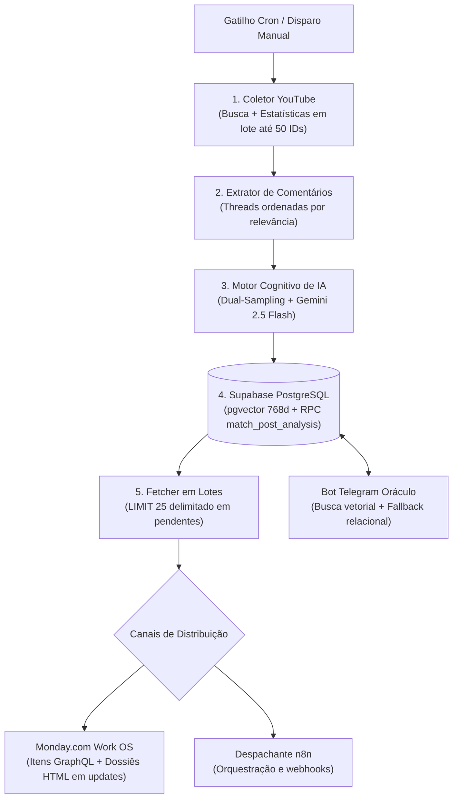

# 🏆 Trend Intelligence Engine — Escuta Semântica & Social RAG

[](https://github.com/jraphaelcunha/trend-intelligence-engine/actions/runs/39533622191)
[](https://www.python.org/)
[](https://docs.pydantic.dev/)
[](https://deepmind.google/technologies/gemini/)
[](https://ai.google.dev/)
[](https://supabase.com/)
[](https://monday.com/)
[](https://n8n.io/)
[](https://telegram.org/)

> **[ 🇺🇸 Read in English ](README.md)**

> **Visão Geral Executiva:** O **Trend Intelligence Engine** é uma plataforma profissional de inteligência de mercado, escuta social profunda e análise semântica desenvolvida a partir do início de 2026. Projetado para extrair sinais de audiência de alta convicção, mudanças emergentes de sentimento e objeções comerciais no ecossistema de vídeos digitais, o sistema opera sob o paradigma de **"Dark Kitchen" de Software**: tarefas pesadas de ingestão, otimização de cotas de API, mineração de comentários e síntese cognitiva via LLM executam como uma **esteira síncrona em etapas sequenciais** via serviços CLI em Python no *backstage* (com filas assíncronas distribuídas previstas no roadmap arquitetural). A inteligência resultante é entregue diretamente aos tomadores de decisão em painéis no **Monday.com** (com dossiês analíticos completos em HTML), fluxos automatizados no **n8n** e consultas interativas via **Telegram Oráculo** integrado a um banco vetorial com pgvector.

---

## 🎯 1. Valor Comercial & Racional de Engenharia

### A Dor do Mercado: Reação Tardia e Cegueira de Sinal
Diretores de marketing, estrategistas de conteúdo e líderes de marcas frequentemente reagem tarde a mudanças culturais e comportamentais do público. Ler manualmente milhares de comentários em centenas de vídeos é impraticável, enquanto ferramentas convencionais de monitoramento baseadas em palavras-chave apenas contabilizam volume superficial, perdendo nuances, sarcasmo, gírias emergentes e atritos reais de produto.

### Contraste Narrativa vs. Reação da Audiência
Em vez de simplesmente resumir títulos e descrições de vídeos, o motor contrasta metodicamente:
* **A Tese do Criador (Narrativa):** O que o influenciador ou canal afirma, defende ou promove na transcrição do vídeo e nos metadados.
* **A Reação Real do Público (Atrito):** O que a audiência efetivamente debate, contesta, questiona ou celebra nas caixas de comentários, revelando objeções comerciais genuínas e percepções de valor do consumidor.

Utilizando o **Gemini 2.5 Flash** com saídas estruturadas em JSON e o **Supabase pgvector (embeddings de 768 dimensões)**, o sistema separa sinais de negócio autênticos do ruído geral das redes.

### Decisões Críticas de Arquitetura
1. **Otimização de Cotas da API do YouTube:** A API v3 do YouTube impõe cota diária padrão de 10.000 unidades. Uma busca (`youtube.search().list`) consome 100 unidades. Requisitar estatísticas individualmente para cada vídeo encontrado consumiria 1 unidade adicional por chamada, esgotando a cota rapidamente. O motor coleta primeiramente os IDs dos candidatos e realiza **requisições em lote de estatísticas** através de `youtube.videos().list(id=','.join(video_ids), part='statistics')` (até 50 IDs por chamada única, consumindo apenas 1 unidade), maximizando a cobertura dentro do limite diário.
2. **Heurística de Dual-Sampling de Comentários:** Injetar centenas de comentários brutos na janela de contexto de um LLM gera custo excessivo de tokens, aumento de latência e dispersão de atenção do modelo. O motor implementa uma estratégia determinística de **Dual-Sampling**:
   * **Top 10 Comentários Mais Curtidos (`top_10`):** Ingeridos integralmente (autor, texto e curtidas) para análise qualitativa profunda, capturando as principais objeções e o sentimento de maior respaldo social.
   * **Amostra de até 100 Comentários (`sample_100`):** Truncados a 150 caracteres cada, fornecendo densidade estatística de sentimento, termos emergentes e dispersão emocional.
   * *Impacto Estimado de Projeto:* Com base na estimativa de contagem de caracteres e tokenização, essa heurística projeta uma economia aproximada de ~65% em tokens comparada ao envio integral de 100 comentários brutos no prompt. Trata-se de uma estimativa de engenharia voltada à redução de custos e foco de atenção do modelo, e não de um benchmark empírico formalizado.
3. **Gestão de Buffer (Lotes Delimitados por Quantidade de Registros):** Ao serializar consultas do banco para o stdout de executores de containers ou nós do n8n, saídas não delimitadas podem estourar os limites de buffer em runtime (como o erro `stdout maxBuffer length exceeded (1MB)` do Node.js). No `src/fetcher.py`, a consulta restringe a quantidade de registros por execução (`WHERE a.exported_to_zapier = FALSE ORDER BY a.id ASC LIMIT 25`) via `RealDictCursor`. Embora o `LIMIT 25` restrinja a contagem de registros e não imponha um teto absoluto em bytes, na prática manteve os payloads observados em cerca de ~300KB nos testes reportados com dossiês HTML, avançando sequencialmente conforme os registros são exportados e marcados no banco.

---

## 🏗️ 2. Arquitetura do Sistema ("The Dark Kitchen")

A esteira opera de forma modular, desacoplando o enriquecimento de dados da apresentação operacional:



### 📡 Camadas do Pipeline

* **Camada de Ingestão (`src/collector.py`):** Consultas orientadas a arquivo de configuração via YouTube API v3. Filtra vídeos por engajamento e visualizações em relação ao tempo de publicação, utilizando buscas de IDs seguidas de chamadas em lote de estatísticas (até 50 vídeos por unidade de cota).
* **Extração de Comentários (`src/scraper.py`):** Capta comentários ordenados por relevância via `youtube.commentThreads().list`, gravando autor, texto, contagem de curtidas e data de publicação com deduplicação no banco relacional.
* **Motor Cognitivo (`src/analyzer.py`):** Combina metadados do vídeo, transcrição do áudio (via `youtube-transcript-api`) e o **corpus em Dual-Sampling** (10 completos + até 100 truncados). Gera saída estritamente estruturada em JSON com o Gemini 2.5 Flash e calcula embeddings vetoriais de 768 dimensões com `models/gemini-embedding-2` gravados no Supabase PostgreSQL.
* **Fetcher em Lotes & Formatador de Payloads (`src/fetcher.py`):** Consulta análises não exportadas em lotes de até 25 registros (`WHERE exported_to_zapier = FALSE ORDER BY id ASC LIMIT 25`) via `RealDictCursor`. Embora limite a quantidade de registros e não garanta um teto rígido em bytes, reduz substancialmente o risco de estouro de buffer no stdout dos executores. Resolve dinamicamente os IDs de grupos no Monday, mapeia status de sentimento, separa seções de narrativa vs. reação e monta dossiês analíticos completos em HTML.
* **Integração Work OS (`src/export_to_monday.py`):** Realiza mutações GraphQL para o Monday.com, criando itens nos grupos correspondentes aos sub-temas e publicando o dossiê detalhado em HTML nos balões de atualização do item.
* **Oráculo Interativo (`src/telegram_oraculo.py`):** Bot no Telegram permitindo consultas em linguagem natural. Converte as perguntas em vetores de 768d e executa busca por similaridade de cosseno via função SQL `match_post_analysis(%s::vector, %s, %s)`, contando com fallback relacional para as últimas 5 análises caso a busca vetorial não retorne correspondências.

---

## ⚽ 3. Configuração Temática: Copa do Mundo 2026

Embora o Trend Intelligence Engine seja estruturado como um framework de inteligência social de propósito geral, uma configuração temática dedicada foi aplicada no início de 2026 para o ecossistema da **Copa do Mundo FIFA 2026**, validando a classificação multi-subtópico e a recepção da audiência sob alto volume:

* **Volume de Execução Reportado:** Registros de execução do projeto reportam **163 vídeos indexados** e um volume estimado de **mais de 150.000 comentários** processados nos sub-tópicos configurados. Trata-se de métricas operacionais relatadas em logs de execução e testes, a validar frente aos registros de banco de dados, e não de uma medição independente de capacidade em produção.
* **Categorização Dinâmica de Sub-temas:**
  * `figurinhas`: Engajamento em torno do álbum Panini, itens colecionáveis e sensibilidade a preços.
  * `tatica`: Análises táticas pós-jogo, avaliações de escalações e comentários esportivos.
  * `duvidas`: Especulações de convocação, debates sobre atletas em boa/má fase e repercussão de listas.
  * `polemicas`: Custos de ingressos, logística da FIFA e atritos operacionais do evento.
  * `influencers`: Conteúdo de criadores em ascensão, reacts e dinâmica de retenção de público.
* **Mapeamento Automático de Grupos:** O motor mapeia dinamicamente cada vídeo para seu grupo correspondente no Monday.com (`Figurinhas da Copa 2026`, `Tática e React de Jogos`, etc.), mantendo a esteira editorial organizada sem intervenção humana.
* **Desacoplamento de Configuração:** Todas as palavras-chave, parâmetros de corte e ângulos analíticos estão isolados em `src/pilots/world_cup_2026/config.yaml`, permitindo a transição direta para outros domínios de mercado ou inteligência corporativa.

---

## 🛡️ 4. Contratos de Dados & Resiliência Arquitetural

### Contratos de Dados & Esquemas (Pydantic v2)
Os contratos de dados são formalmente declarados com modelos Pydantic v2 em `src/models/schemas.py` (`VideoMetadata`, `CommentPayload`, `SentimentAnalysisResult` e `MondayItemPayload`), definindo os esquemas tipados esperados entre as camadas de coleta, análise e distribuição. Na execução atual do pipeline, o fluxo interno trafega predominantemente como dicionários estruturados em Python, com a imposição estrita de validação em runtime sendo expandida progressivamente entre todas as etapas.

### RAG Defensivo com Fallback Relacional
No `src/telegram_oraculo.py`, as consultas ao repositório utilizam similaridade de cosseno com pgvector:
```sql
SELECT * FROM match_post_analysis(query_embedding::vector, match_threshold, match_count);
```
Caso a busca vetorial não encontre resultados satisfatórios ou ocorra indisponibilidade no índice vetorial, o sistema degrada graciosamente para uma busca relacional, retornando os 5 dossiês mais recentes ordenados por data de análise.

---

## 🔍 5. Status de Engenharia, Quality Gates & Avaliação de IA

Para garantir absoluta transparência técnica sobre a qualidade de código, resiliência e rigor metodológico:

* **Quality Gate de CI Estritamente Bloqueante:** O workflow no GitHub Actions aplica verificação rigorosa com o Ruff (executado sem `--exit-zero`), bloqueando violações das regras estáticas configuradas em `src/` e `tests/`. Com os PRs #2 e #3 mesclados na `main`, a execução remota de CI ([39533622191](https://github.com/jraphaelcunha/trend-intelligence-engine/actions/runs/39533622191)) está 100% VERDE. Lint não garante correção em runtime nem tratamento completo de exceções.
* **Cobertura de Testes Empírica (77% Medida):** A suíte revisada mede **77% de cobertura global de declarações**, com 88 testes determinísticos de unidade, comportamento e avaliação (incluindo resiliência a timeouts HTTP calibrados). A cobertura é arredondada pelo pytest-cov e pode ser reproduzida pelos comandos abaixo.
* **Testes Abrangentes de Comportamento:**
  * **Resiliência de Ingestão:** Agregação de estatísticas em lote na API do YouTube (`videos().list(id=','.join(ids), part='statistics')`), filtros de corte por visualizações/engajamento e tratamento de listas vazias em `src/collector.py`.
  * **Raspagem de Comentários:** Extração oficial de comentários via YouTube Data API com tolerância a comentários desativados e inserção idempotente no banco em `src/scraper.py`.
  * **Motor Cognitivo Dual-Sampling:** Validação de casos extremos em `src/analyzer.py` para conjuntos vazios de comentários, amostras reduzidas (<10 comentários), amostras amplas (>100 comentários), fallback de transcrição ausente, remoção de delimitadores markdown (` ```json `) e coerção estrita de sentimentos.
  * **Integrações Corporativas:** Montagem de mutations GraphQL para criação de itens e balões de atualização rich-text no Monday.com, resolução de grupos e higienização de strings em `src/export_to_monday.py`; busca vetorial por cosseno no Supabase pgvector e fallback relacional em `src/telegram_oraculo.py`; retry de conexão com backoff exponencial em `src/utils/db.py`.
* **Fundação de Avaliação de IA Offline (`tests/evals/`):**
  * **Fixtures de Benchmark Sintético:** Fixtures offline controladas (`sentiment_goldens.json`, 12 amostras) utilizadas para testes determinísticos de regressão e aferição de pipelines.
  * **Pós-Processamento e Normalização de Sentimento:** Avalia o mapeamento determinístico de normalização de sentimentos (`map_sentiment`) nas classes "Positivo", "Negativo" e "Neutro" sobre as 12 amostras do benchmark (Acurácia: 1.000, Macro-F1: 1.000). *Nota: Mede a lógica determinística de pós-processamento e coerção de schema, não a acurácia do modelo Gemini em produção aberta.*
  * **Testes Algorítmicos de Ranking de Recuperação:** Avalia a função de cálculo de ranking por cosseno (`rank_documents`) em vetores sintéticos direcionais de 4 dimensões para 4 consultas de teste (Recall@1: 100%, Recall@3: 100%, MRR: 1.000). *Nota: Valida a matemática de ranking e a lógica de fallback, não a qualidade empírica de recuperação sobre um corpus massivo em produção no pgvector.*
  * **Tratamento de Conteúdo Adversarial e Não Confiável:** Testes unitários sistemáticos comprovando que defesas locais — rejeição por contratos Pydantic v2, truncamento de strings, parametrização segura no SQL e coerção defensiva de respostas não-JSON ou literais inválidos — exercitam os casos específicos das fixtures. Não comprovam ausência de exceções não tratadas ou corrupção de dados. *Nota: Comprovam resiliência de parsing e validação de entrada no pipeline local, não imunidade absoluta a ataques sofisticados de jailbreak de LLMs em produção.*

---

## 🚀 6. Como Executar Localmente


**Comece pelos testes offline:** a suíte não precisa de credenciais. Os comandos CLI abaixo acessam serviços externos e podem consumir cotas. As tabelas e a função `match_post_analysis` devem existir previamente; o repositório não inclui migrações de inicialização.

**Deploy pendente:** consulte [operações de segurança](docs/SECURITY_OPERATIONS.md) antes de executar containers ou fazer deploy. Injete a chave existente do n8n e a senha do banco externamente após backup; não gere outra chave para uma instalação existente. O Compose usa PostgreSQL remoto, sem banco local incluído.

**Limitação dos embeddings:** 768d é a dimensão documentada do banco. O código não solicita explicitamente essa dimensão; a compatibilidade entre saída do modelo e schema não foi comprovada pelos testes offline.

### Pré-requisitos
* Python 3.11+
* Docker & Docker Compose (opcional, para instâncias locais do n8n)
* Chaves de API configuradas:
  * YouTube Data API v3 (`YOUTUBE_API_KEY`)
  * Google Gemini API (`GEMINI_API_KEY`)
  * String de conexão PostgreSQL do Supabase (`DATABASE_URL`)
  * Token da API Monday.com (`MONDAY_API_TOKEN`)
  * Token de Bot do Telegram (`TELEGRAM_BOT_TOKEN`, opcional para o Oráculo)

### Instalação
```bash
# 1. Clonar o repositório
git clone https://github.com/jraphaelcunha/trend-intelligence-engine.git
cd trend-intelligence-engine

# 2. Configurar o ambiente virtual
python -m venv venv
source venv/bin/activate  # No Windows: venv\Scripts\activate

# 3. Instalar dependências
pip install -r requirements.txt

# 4. Configurar variáveis de ambiente
cp .env.example .env
# Preencher .env com suas chaves reais
```

### Execução dos Módulos
```bash
# Executar coleta no YouTube para a configuração temática ativa
python src/collector.py

# Extrair comentários dos vídeos indexados
python src/scraper.py

# Executar enriquecimento cognitivo com Gemini 2.5 Flash
python src/analyzer.py

# Exportar dossiês pendentes para o Monday.com
python src/export_to_monday.py

# Inicializar o bot interativo do Telegram Oráculo
python src/telegram_oraculo.py
```

### Executando Testes e Avaliações de IA
```bash
# Executar a suíte completa de testes com relatório de cobertura
pytest tests/ -v --cov=src --cov-report=term-missing

# Executar especificamente o benchmark offline de Avaliação de IA
pytest tests/evals/ -v
```

### Executando com Docker Compose
```bash
docker compose --env-file .env -f docker/docker-compose.yml up --build -d
```
A interface do n8n estará acessível em [http://localhost:5678](http://localhost:5678).

---

## 📂 7. Estrutura Canônica do Repositório

```text
trend-intelligence-engine/
├── .github/
│   └── workflows/
│       ├── ci.yml                     # Automação de CI estritamente bloqueante (Ruff + Pytest)
│       └── google-cloudrun.yml        # Workflow de deploy no Google Cloud Run
├── docker/                            # Arquivos Dockerfile multi-stage e Compose
├── n8n/                               # Exportações dos fluxos do n8n
├── src/                               # Código-fonte principal em Python
│   ├── models/
│   │   └── schemas.py                 # Contratos de dados em Pydantic v2
│   ├── collector.py                   # Ingestão do YouTube com estatísticas em lote
│   ├── scraper.py                     # Extração de comentários e deduplicação
│   ├── analyzer.py                    # Motor cognitivo Gemini 2.5 Flash e embeddings 768d
│   ├── fetcher.py                     # Fetcher delimitado de 25 registros e formatador Monday
│   ├── export_to_monday.py            # Exportador direto para GraphQL da Monday.com
│   ├── telegram_oraculo.py            # Assistente RAG conversacional com fallback relacional
│   ├── utils/
│   │   └── db.py                      # Resiliência de conexão e retry com Supabase PostgreSQL
│   └── pilots/
│       └── world_cup_2026/            # Configuração temática & taxonomia de sub-temas
├── scripts/
│   └── ops/                           # Utilitários de manutenção operacional e de banco
├── tests/
│   ├── conftest.py                    # Fixtures globais e mocks determinísticos para Pytest
│   ├── evals/                         # Suíte de avaliação de IA offline e robustez adversarial
│   │   ├── fixtures/
│   │   │   └── sentiment_goldens.json # Benchmark sintético com ground truth fixo
│   │   ├── test_sentiment_eval.py     # Avaliação de Acurácia e Macro-F1 de classificação
│   │   ├── test_retrieval_eval.py     # Harness de avaliação de Recall@K e MRR no RAG
│   │   └── test_adversarial_inputs.py # Defesas contra injeção de prompt e dados maliciosos
│   └── unit/
│       ├── test_schemas.py            # Testes de validação dos contratos Pydantic
│       ├── test_fetcher.py            # Testes de mapeamento e transformação
│       ├── test_analyzer.py           # Testes de Dual-Sampling, parsing e persistência
│       ├── test_collector.py          # Testes de busca, estatísticas em lote e filtros
│       ├── test_scraper.py            # Testes de extração de comentários e resiliência
│       ├── test_export_to_monday.py   # Testes de mutations GraphQL de itens e updates Monday
│       ├── test_telegram_oraculo.py   # Testes de busca vetorial e fallback relacional
│       ├── test_db.py                 # Testes de resiliência e retry de conexão do banco
│       └── test_n8n_exporter.py       # Testes de serialização e envio ao webhook n8n
├── pyproject.toml                     # Configuração do linter Ruff e cobertura Pytest
├── requirements.txt                   # Dependências de produção
├── README.md                          # Documentação técnica em inglês
└── README.pt-br.md                    # Documentação técnica em português
```

---

## 🗺️ 8. Próximos Passos (Roadmap)

- [ ] **Ingestão Multiplataforma:** Expandir a coleta além do YouTube para transcrições de vídeos curtos no TikTok e Instagram Reels.
- [ ] **Roteamento Multi-Board no Monday:** Suporte dinâmico a múltiplos boards corporativos via cabeçalhos e tokens nas requisições do n8n.
- [ ] **Alertas Ativos de Tendência:** Disparo de notificações proativas no Telegram quando um sub-tema apresentar picos anômalos de atrito ou engajamento.
- [ ] **Filas de Tarefas Assíncronas:** Evoluir os scripts CLI síncronos em etapas para workers assíncronos com filas distribuídas (ex.: Celery/Redis ou loop de tarefas em asyncio) para ingestão paralela de alta concorrência.

---

## 👤 Autor

**João Raphael Cunha**<br/>
Solutions Architect & AI Engineer<br/>
[Perfil no GitHub](https://github.com/jraphaelcunha) | [LinkedIn](https://www.linkedin.com/in/joaoraphaelcunha/)
